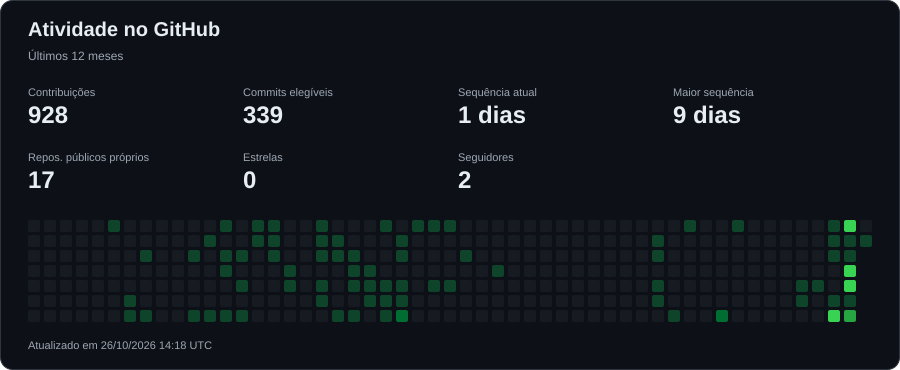

# Allan de Melo Correa

**Desenvolvedor Web | React, Next.js, Python e SQL**

Sou formado em Análise e Desenvolvimento de Sistemas e atuo no desenvolvimento de sites, aplicações web e soluções para processos de negócio.

Minha experiência reúne projetos para clientes, interfaces responsivas, APIs e bancos de dados. Também trabalho com SQL Server, tratamento e migração de dados e melhorias em sistemas empresariais, conectando desenvolvimento às necessidades de quem utiliza as aplicações.

Nos projetos pessoais, aprofundo minha prática com autenticação, integração entre front-end e back-end, testes e execução local de modelos de IA. O Nexora AI é um desses projetos: um assistente local em desenvolvimento com Next.js, FastAPI e Ollama.

**Busco oportunidades em desenvolvimento web**, com interesse em contribuir para uma equipe, aprender com outros profissionais e participar da construção e evolução de aplicações.

[Portfólio](https://meu-portifolio-dun-two.vercel.app/) · [LinkedIn](https://www.linkedin.com/in/allandemelocorrea-45875016a) · [E-mail](mailto:demelocorrea1@outlook.com)

---

## Tecnologias nos meus projetos

| Área | Tecnologias |
| --- | --- |
| Front-end | HTML, CSS, JavaScript, TypeScript, React, Next.js, Tailwind CSS, Bootstrap e shadcn/ui |
| Back-end | Python, Django, Flask, FastAPI e PHP |
| Dados e persistência | SQL Server, MySQL, SQLite, Cloudflare D1, Prisma, SQLAlchemy e Drizzle ORM |
| Sites e e-commerce | Shopify, Liquid, WordPress e Elementor Pro |
| Ferramentas e publicação | Git, GitHub, Docker, Vercel e Cloudflare Workers |
| IA local em desenvolvimento | Ollama e integração de modelos por API |

---

## Projetos em destaque

<!-- PROJECTS:START -->

As imagens são prévias dos repositórios; demonstrações estão nos respectivos projetos.

**[Nexora AI](https://github.com/allancorreaz/Nexora-AI)** · TypeScript

IA para auxiliar pós treinamentos, usando transcrições de treinamentos e documentação do sistema no qual está sendo treinado.

**[Centro de Controle da Implantação](https://github.com/allancorreaz/Gestao-de-Implantacao)** · Python

Gestão de implantação de sistemas

**[Aprovados Questões](https://github.com/allancorreaz/AprovadosQuestoes)** · JavaScript

Site teste com questoes pra treinar pra concursos específicos

**[Registro Operacional](https://github.com/allancorreaz/registro-operacional)** · JavaScript

Registro das operações dos equipamentos portuários.

**[Aprisco Urbano](https://github.com/allancorreaz/apriscourbano)** · TypeScript

site igreja aprisco urbano

**[Controle de Vendas e Estoque](https://github.com/allancorreaz/vendas-e-estoque)** · TypeScript

sistema de controle de vendas e estoque

Outros projetos e estudos

**[Portfólio pessoal](https://github.com/allancorreaz/Portif-lio)** · HTML

Meu portifólio dev

**[FSW Barber — Em desenvolvimento](https://github.com/allancorreaz/fsw-barber)** · TypeScript

Projeto de estudo em desenvolvimento para uma aplicação de barbearia com Next.js e Prisma.

**[FWS BarberShop Service — Em desenvolvimento](https://github.com/allancorreaz/FWS-BarberShopService)** · TypeScript

Saas pra barberarias.

**[Sants Company](https://github.com/allancorreaz/santscompany)** · HTML

Site para Agência de marketing e programação.

**[Financeiro App](https://github.com/allancorreaz/financeiro-app)** · Python

controle financeiro pessoal, testes

**[calendar2x2](https://github.com/allancorreaz/calendar2x2)** · JavaScript

adjustable calendar for shift workers

**[tic tac toe](https://github.com/allancorreaz/tic-tac-toe)** · JavaScript

jogo da velha

**[Projeto Glass](https://github.com/allancorreaz/Projeto-Glass)** · HTML

Curso em Video HTML5

[Todos os repositórios](https://github.com/allancorreaz?tab=repositories)

Atualização automática a cada hora. Novos repositórios públicos próprios aparecem nesta seção; forks, repositórios vazios e privados ficam de fora.

<!-- PROJECTS:END -->

---

## Projetos web em que participei

- [Neuraw](https://www.neuraw.com.br)
- [Casa Sol Project](https://www.casasolproject.com)
- [Florida Pool Plastering](https://www.floridapoolplastering.com)
- [Florida Pool Plastering — Builder](https://www.floridapoolplastering.com/builder)
- [Ocean Pools FL](https://www.oceanpoolsfl.com)

---

## Atividade no GitHub

As estatísticas são geradas neste repositório a partir da API do GitHub. Contribuições e sequências usam a janela dos últimos 12 meses; repositórios, estrelas e seguidores representam totais atuais públicos. A sequência conta dias com contribuições, não o número de commits.

A atualização é agendada a cada hora, pode sofrer atrasos do GitHub Actions e também pode ser executada em [Actions](https://github.com/allancorreaz/allancorreaz/actions/workflows/update-profile.yml). O GitHub pode levar até 24 horas para contabilizar contribuições elegíveis.

---

## Contato

 

---

  
  

